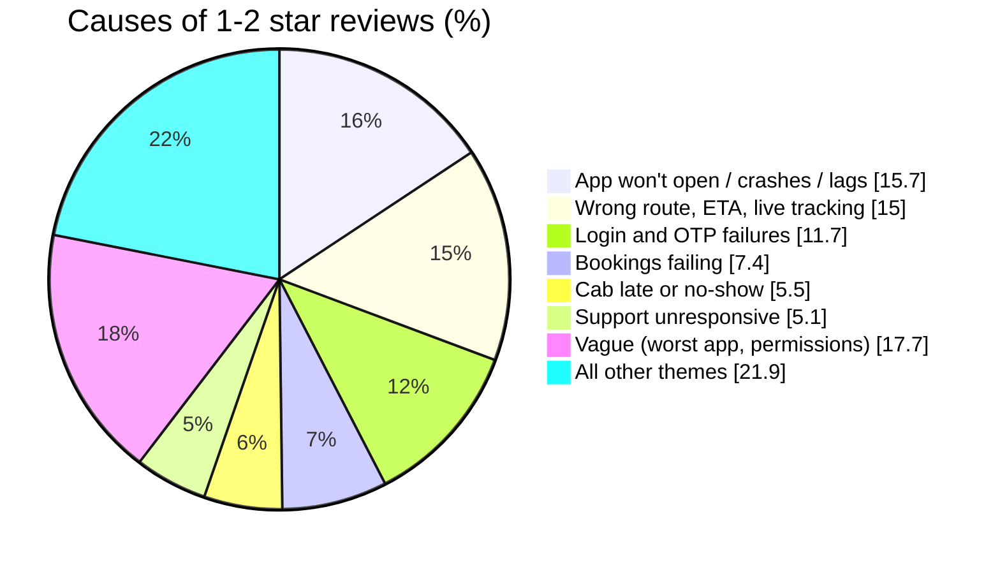
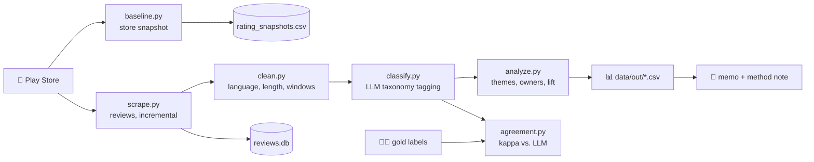
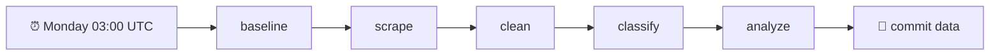

<div align="center">

# 🚕 MoveInSync Play Store Ratings Analysis

### *Why is the rating where it is, and what should we fix first?*


**App:** `com.moveinsync.ets` &nbsp;|&nbsp; **Market:** India &nbsp;|&nbsp; **App rating:** ⭐ 4.64 from 114,881 ratings

[📊 Dashboard](app/dashboard.py) · [📝 Memo](reports/memo.md) · [🔬 Method note](reports/method_note.md) · [📌 Assumptions](reports/assumptions.md) · [🎯 Scope](reports/scope.md) · [🏷️ Taxonomy](prompts/taxonomy.md)

</div>

---

## 🔍 The answer in 30 seconds

The 4.64 app rating hides a very different story among people who write reviews.

| | Store (all ratings) | Written reviews (last 90 days) |
| :--- | :---: | :---: |
| **Average** | ⭐ 4.64 | ⭐ **3.81** |
| **1–2 star share** | 7.1% | **28%** |
| **Trend** | creeping up | flat vs. prior 90 days (3.82, 27%) |

> **It is a chronic problem, not a new collapse.** The written-review average has crept up slowly from 3.45 (2022) to 3.85 (2026), but a stubborn core of complaints never goes away.

### 🎯 What reviewers complain about

Share of 434 classified 1–2 star reviews (Feb–Oct 2026):



### 🔥 Top three fixes

| # | Fix | Share of complaints | Owner (suspected) | Est. lift on 90-day average |
| :-: | :--- | :---: | :--- | :---: |
| 1 | **App won't open / crashes** | 15.7% (31.7% in last 30 days 📈) | App engineering | +0.08 to +0.17 |
| 2 | **Login and OTP failures** | 11.7% | Engineering, backend, client IT | +0.06 to +0.13 |
| 3 | **Route, ETA and live tracking** | ~15% | Backend routing, product | +0.08 to +0.16 |

Booking failures (7.4%) are next in the queue. Each ticket in the [memo](reports/memo.md) has the evidence, a hypothesis, a validation step, acceptance criteria and a success metric, so a team can start the next day.

> ⚠️ Owners and causes are **suspicions from review text**, not verified root causes. Every fix starts with a validation step on internal data.

---

## 🧭 How it works



| Step | Script | Reads | Writes |
| :-: | :--- | :--- | :--- |
| 1️⃣ | `src/baseline.py` | Play Store app page | a row in `data/rating_snapshots.csv` (score, star histogram, version) |
| 2️⃣ | `src/scrape.py` | Play Store reviews | table `reviews` in `data/reviews.db`, deduplicated by review ID |
| 3️⃣ | `src/clean.py` | `reviews` | table `reviews_clean`: language tag, word count, `too_short`, 24-month and 90-day windows, `send_to_llm` |
| 4️⃣ | `src/classify.py` | `reviews_clean` | table `reviews_llm`: theme, journey stage, sentiment, severity, suspected owner, evidence quote, confidence |
| 5️⃣ | `src/agreement.py` | `gold_overlap.csv` + `reviews_llm` | agreement and Cohen's kappa |
| 6️⃣ | `src/analyze.py` | all tables | theme shares, owner split, rating-lift simulation, version and emerging-theme checks in `data/out/` |

**Built to be re-run.** Scraping stops when it reaches reviews it already has, and classification skips anything already in `reviews_llm`, so an interrupted run simply resumes. Every classified row stores its model and prompt version, so results stay traceable.

---

## 🏷️ The taxonomy

Every review gets **one primary theme** (plus optional secondary themes) from 19 labels, mapped to the employee journey. Full definitions and labelling rules are in [`prompts/taxonomy.md`](prompts/taxonomy.md).

| Journey stage | Themes |
| :--- | :--- |
| 🔐 **Onboarding / access** | `login_otp` |
| 📅 **Booking** | `booking_failure`, `rating_prompt`, `feature_request` |
| 🚖 **Assignment and pickup** | `cab_late_no_show`, `wrong_route_eta`, `notifications` |
| 📍 **Tracking** | `live_tracking_gps` |
| 🪪 **Boarding** | `boarding_verification` |
| 🛡️ **Safety and conduct** | `safety`, `driver_behavior` |
| 📱 **Whole app** | `crash_lag`, `ui_confusion`, `update_issue` |
| 🎧 **Issue handling** | `support_unresponsive`, `billing_payment` |
| 🙂 **Other** | `praise`, `misdirected_review`, `other` |

Each classification also carries a **severity (1–5)**, a **suspected owner** (`app_engineering`, `backend_routing`, `operations`, `client_policy`, `support_process`, `unclear`), an **evidence quote** and a **confidence score**.

---

## ✅ How much to trust it

| Check | Result |
| :--- | :--- |
| Store score vs. star histogram | Weighted average reconciles to **4.6389** ✔️ |
| Reviews collected | **24,318** (2014 to 11 Oct 2026), second run added 0 duplicates ✔️ |
| Classified | **990 of 3,178** eligible reviews (credit limit), newest first |
| Theme agreement vs. gold labels (n=27) | **0.89** (κ = 0.87) |
| Owner agreement vs. gold labels (n=27) | **0.81** (κ = 0.67) |
| Complaint vs. not | **1.00** |
| Version 12.19.0 regression? | z = 1.40, **not significant** |

> With n = 27, one review moves agreement by about 4 points, and the gold labels were AI-drafted then human-reviewed, so treat these as indicative. See the [method note](reports/method_note.md) for the full discussion.

---

## 🚀 Quick start

```powershell
# 1. Environment (Python 3.11+)
python -m venv .venv
.venv\Scripts\Activate.ps1        # Linux/macOS: source .venv/bin/activate
pip install -r requirements.txt

# 2. Key for the classification step (or put it in a gitignored .env file)
$env:OPENROUTER_API_KEY = "sk-or-..."

# 3. Run the pipeline
python src/baseline.py
python src/scrape.py              # add --full for a complete re-pull
python src/clean.py
python src/classify.py --limit 30 # small test run first
python src/classify.py            # full run (spends API credits)
python src/analyze.py

# 4. Launch the interactive dashboard
streamlit run app/dashboard.py
```

> 💡 Everything except `classify.py` is free and needs no key.

**Configuration** lives in [`config.yaml`](config.yaml): app list, country, languages, `llm_model` and `prompt_version`. If you change the taxonomy or prompt, bump `prompt_version` and reclassify.

---

## 🗂️ Repository layout

```text
moveinsync-ratings/
├── config.yaml              apps, country, languages, model, prompt version
├── prompts/
│   └── taxonomy.md          taxonomy and labelling rules fed to the LLM
├── app/
│   ├── dashboard.py         interactive Streamlit dashboard
│   ├── charts.py            Plotly visualizations & figure builders
│   ├── loaders.py           cached SQLite & snapshot CSV loaders
│   ├── backlog.yaml         ticket backlog and owner action metadata
│   └── theme.py             color tokens and UI styling
├── src/
│   ├── baseline.py          store score + star histogram snapshot
│   ├── scrape.py            incremental review ingestion
│   ├── clean.py             language, length, windows, LLM eligibility
│   ├── classify.py          LLM theme tagging (pydantic-validated JSON)
│   ├── agreement.py         agreement + kappa vs. gold labels
│   └── analyze.py           themes, owners, lift simulation, version checks
├── data/
│   ├── reviews.db           SQLite: reviews, reviews_clean, reviews_llm
│   ├── rating_snapshots.csv app rating history, one row per run
│   ├── gold_labels.csv      80 sampled reviews with checked labels
│   ├── gold_overlap.csv     gold rows inside the classified set
│   └── out/                 analysis output tables
├── reports/
│   ├── memo.md              recommendation memo
│   ├── method_note.md       method, validation, limitations, tools
│   ├── assumptions.md       assumptions made
│   └── scope.md             what is in and out of scope
└── .github/workflows/
    └── weekly.yml           scheduled refresh
```

---

## 🔁 Weekly refresh

`.github/workflows/weekly.yml` runs the pipeline every Monday (or on demand) and commits the refreshed `reviews.db`, `rating_snapshots.csv` and `data/out/`.



Add `OPENROUTER_API_KEY` as a repository secret first. The classify step spends credits on new eligible reviews, and the first run would classify the whole unclassified backlog, so consider finishing that locally before enabling the schedule.

---

## ⚠️ Known limitations

- 🗣️ **Reviewers are not all users.** 28% of written reviews are 1–2 star against 7% of all ratings, so theme shares describe complaints among reviewers.
- 📉 **Partial classification.** Only 31% of eligible reviews were classified because of API credit limits, covering about 8 months.
- 🧪 **Small gold set.** 27 overlapping labels, AI-drafted then human-reviewed, oversampling low ratings.
- 🕵️ **Suspicions, not causes.** Public data cannot confirm root causes. No crash logs, OTP logs, support tickets or in-app rating-prompt logic were available.
- 🌫️ **17.7% of complaints are vague** ("worst app"), so named-theme shares are conservative.

---

## 🛠️ Tools used

Python · `google-play-scraper` · pandas · SQLite · pydantic · Streamlit · Plotly · an LLM via OpenRouter · an AI assistant for planning, code drafting and a first draft of gold labels. Every script was run and checked against the store histogram and manual reading of the reviews.

<div align="center">

*Built to answer "How are our Play App ratings?" every time it is asked.*

</div>
